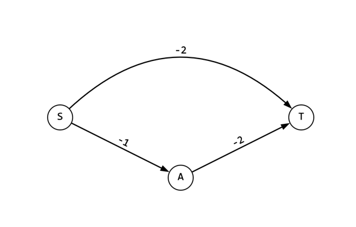

# Алгоритм Дейкстры.
[`Heap`](heap.py#L10-L181) реализация кучи, взята из прошлой задачи.

[`Graph`](graph.py#L1-L45) — реализация ориентированного взвешенного графа (петли разрешены, параллельные рёбра — нет).

[`shortest_path_dijkstra`](dijkstra.py#L7-L26) — требуемая функция, алгоритм Дейкстры.

## Анализ асимптотики
Здесь $V$ — кол-во вершин в графе, а $E$ — кол-во рёбер в графе.

В [цикле](dijkstra.py#L13-L22) обрабатываем рёбра из `queue`. Если конечная вершина ребра уже раскрыта пропускаем её, иначе раскрываем. Каждое ребро обрабатывается не более одного раза, а каждая обработка занимает $$O(\log E)≤O(\log(V^2))=O(2\log(V))=O(\log(V))$$ ⇒ цикл работает за $O(E\log(V))$.

[Заполнение](dijkstra.py#L23-L25) расстояний для недостижимых вершин работает за $O(V)≤O(E\log(V))$ ⇒ Суммарная асмптотика — $O(E\log(V))≤O((V+E)\log(V))$.

## Почему отрицательные рёбра недопустимы?
Алгоритм Дейкстры корректен только, когда рёбра графа неотрицательны, потому что предполагает, что расстояния до вершин нестрого возрастают. На каждом шаге алгоритм раскрывает вершину, до которой текущие расстояния наименьшие. Алгоритм предполагает, что он больше не будет обрабатывать эту вершину. Действительно, если расстояния не уменьшаются, то никакой другой путь до раскрываемой вершины не может быть короче найденного, так как обязан пройти через другие вершины кучи, до которых расстояние не меньше. Из-за отрицательных рёбер расстояния перестают быть возрастающими, и ломается корректность алгоритма.

Наивное решение: увеличить значения всех весов рёбер на одно и то же число, таким образом, чтобы отрицательные рёьра перестали быть таковыми. Но, к сожалению, при таком изменении весов не сохраняется структура кратчайших путей: кратчайший путь от одной вершины до другой может измениться и включать в себя другие рёбра. Пример:

Если в этом графе прибавить к весам всех рёбер хотя бы 2, то путь через вершину A перестанет быть кратчайшим. Дело в том, что такое преобразование добавляет к пути надбавку, пропорциональную кол-ву рёбер в нём. Как следствие, более короткие пути проигрывает тем, что содержат меньшее кол-во рёбер. Вообще, если прибавить число сильно большее модулей весов, кратчайшим путём окажется тот, что содержит наименьшее кол-во рёбер, что необязательно верно в исходном графе.

На самом деле моя [функция](dijkstra.py#L7-L26) кидает исключение, только если алгоритм Дейкстры непосредственно наткнётся на отрицательное ребро; если отрицательное ребро недостижимо из стартовой вершины ошибки не будет. Действительно, для всех недостижимых вершин расстояние = ∞.

## Тесты
Тесты находятся в [`main.py`](main.py). [`graph_examples.py`](graph_examples.py) — вспомогательный модуль для генерации примеров графов.
